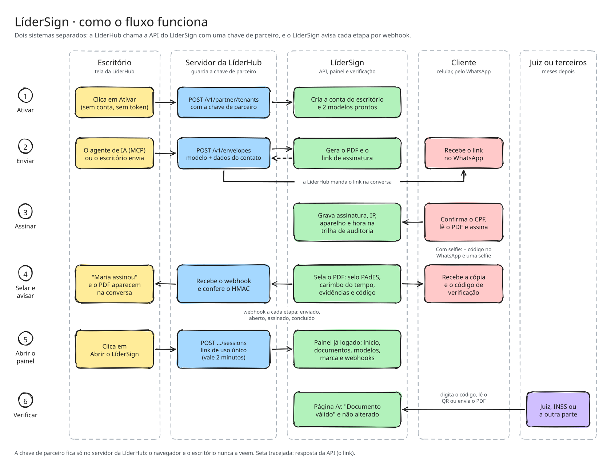

# LíderHub · Contratos

O módulo de contratos da LíderHub: o cliente assina **dentro da conversa do WhatsApp**, sem abrir link. O escritório acompanha cada etapa na Caixa de entrada, o funil de assinatura em Contratos e pede ao Assistente quem parou. Todo documento sai como PDF selado, com carimbo do tempo e página de evidências.

> Projeto de demonstração para o desafio técnico da LíderHub. Escritório, contatos, CPFs e telefones são fictícios. O repositório se chama LíderSign porque nasceu como assinador; nesta versão ele é uma parte da LíderHub, não um produto separado.


## Do feedback para esta versão

| O que apareceu no feedback                                                      | O que mudou                                                                                                                                                                    |
| ------------------------------------------------------------------------------- | ------------------------------------------------------------------------------------------------------------------------------------------------------------------------------ |
| Só gerar um link não basta: a senhora que não sabe clicar em link não assina    | **A assinatura acontece na conversa:** ela digita o CPF, recebe o PDF, ouve um resumo em áudio e toca no botão **Assinar**. O link vira plano B, no botão **Ver no navegador** |
| Tem que ser um produto só, nativo da LíderHub                                   | Saíram a ativação, a chave na tela, o link de entrada, os webhooks entre sistemas e o painel separado. É uma LíderHub com Caixa de entrada, Contratos, Modelos e Assistente    |
| Só cerca de 10% dos contratos enviados pela ZapSign fecham; a meta é 90% a 100% | **Funil por etapa** em Contratos (recebeu, abriu, confirmou o CPF, assinou), com a taxa de fechamento comparada a um histórico de exemplo do ZapSign                           |
| Quem para no meio precisa de um empurrão                                        | **Lembrete na própria conversa**, de acordo com a etapa em que a pessoa parou (CPF, dúvida ou selfie). Automático depois de 24 h, ou no botão **Lembrar**                      |
| Aviso de "novo contrato assinado"                                               | Sino com contador e aviso na tela, em qualquer página                                                                                                                          |
| O Assistente com uma sugestão em cada tela                                      | Painel **Pergunte ao Assistente** no padrão da LíderHub: quem não assinou, lembrar quem parou, taxa de fechamento e **criar modelo a partir de um PDF anexado**                |
| O carimbo do tempo parecia faltar                                               | Fica à vista: na nota interna da conversa ("PDF selado") e em **Garantias do documento**, com o `.tsr` para baixar                                                             |

## Rodar em um comando

Precisa só do Docker.

```bash
docker compose up --build
```

Abra **http://localhost:3000** e clique em **Entrar no escritório**. A entrada sem senha só funciona no próprio computador: pelo túnel público ou por outra máquina da rede, a área do escritório não abre.

### Roteiro de demonstração (5 minutos)

1. **Caixa de entrada:** a conversa da Maria Aparecida (BPC/LOAS) já tem o que o agente de IA levantou. Clique em **Enviar contrato** e escolha **Na própria conversa**.
2. **Celular da Maria:** a aba com o ícone de celular mostra o WhatsApp dela (simulado). Digite um CPF errado e depois o certo, `529.982.247-25`. Chegam o PDF, o resumo em áudio (toque no play) e os botões.
3. **Tenho uma dúvida:** pergunte "Quanto vou pagar?". A resposta usa só o texto do contrato.
4. **Assinar:** na conversa do escritório aparecem as notas internas (CPF confirmado, assinado, PDF selado com carimbo do tempo), o sino avisa "Novo contrato assinado" e a via assinada chega no celular dela.
5. **Contratos:** o funil da conversa contra o histórico do ZapSign, a lista com "onde parou" e o botão **Lembrar**. Clique no nome para ver a trilha e as garantias.
6. **Assistente:** "Quem ainda não assinou?", "Lembre quem parou" e o clipe para anexar um contrato em PDF ou Word, que vira modelo com os campos marcados.
7. **Procuração do João:** nível com selfie. Depois do CPF e do botão Assinar, a conversa pede a selfie: toque na câmera e em **Enviar selfie de exemplo**.
8. **Plano B:** no celular simulado, **Ver no navegador** manda um link. O `docker compose` sobe um túnel HTTPS da Cloudflare, então o link abre no seu celular de verdade (o CPF é pedido de novo no navegador). `docker compose stop tunnel` desliga o túnel.

**Recomeçar do zero:** menu do usuário, no canto inferior esquerdo, **Recomeçar a demonstração**.

Não precisa de conta de WhatsApp nem de chave de IA: tudo tem um modo local.

## Como a assinatura na conversa funciona



Para editar o diagrama, abra [`docs/fluxo.excalidraw`](docs/fluxo.excalidraw) no [Excalidraw](https://excalidraw.com).

Cada envio pela conversa é uma máquina de estados (`apps/api/src/whatsapp/conversation.service.ts`):

```
AGUARDANDO_CPF ──▶ AGUARDANDO_DECISÃO ⇄ DÚVIDA ──▶ [SELFIE] ──▶ ASSINADO ──▶ VIA ENVIADA
       └──▶ BLOQUEADO (5 tentativas de CPF)        └──▶ Ver no navegador (link pessoal, CPF de novo)
```

- O mesmo motor atende o **celular simulado** (`POST /v1/whatsapp/simulator`, só no modo demonstração) e o **webhook da Meta** (`POST /v1/whatsapp/webhook`, conferido pelo `X-Hub-Signature-256`).
- Os botões são os _reply buttons_ do WhatsApp (até 3, título de até 20 caracteres): **Assinar**, **Tenho uma dúvida** e **Ver no navegador**. O aceite vale só pelo botão, para a evidência ser inequívoca: escrever "sim" faz os botões voltarem.
- O PDF vai como mensagem de documento, por um link assinado com HMAC e válido por 1 hora (`/v1/whatsapp/media/:id`).
- O resumo e as respostas às dúvidas usam o Claude quando há `ANTHROPIC_API_KEY`. Sem chave, um roteiro reserva monta o resumo pelos campos do contrato e responde citando o trecho do próprio contrato.
- O CPF digitado é conferido pelo hash e fica gravado mascarado na conversa.

### O que fica de prova

A página de evidências registra o canal: **CPF digitado e conferido na conversa**, **posse do número de WhatsApp** (a conversa só acontece com aquele número), **aceite pelo botão Assinar** com o id da mensagem e, na procuração, a **selfie** enviada pela câmera do WhatsApp. Pelo link, ficam IP e dispositivo, como antes. Assinatura feita no celular simulado sai marcada como **simulada, sem valor de prova**.

| Nível      | Na conversa                             | Pelo link (plano B)                   | Uso                                           |
| ---------- | --------------------------------------- | ------------------------------------- | --------------------------------------------- |
| Padrão     | CPF + posse do WhatsApp + botão Assinar | Link pessoal + CPF + IP e dispositivo | Contratos de honorários                       |
| Com selfie | Padrão + selfie pela câmera do WhatsApp | Padrão + código no WhatsApp + selfie  | Procurações e declarações em litígio de massa |

Todo PDF sai com rodapé de verificação, bloco de assinatura, página de evidências, **selo PAdES** (`ETSI.CAdES.detached`) e **carimbo do tempo RFC 3161** sobre o hash do original. A assinatura eletrônica com evidências de autoria e integridade tem amparo na MP 2.200-2/2001 (art. 10, § 2º), e a Lei 14.063/2020 serve de referência para os tipos de assinatura (simples, avançada e qualificada), embora trate das interações com o poder público. O [STJ (REsp 2.223.695)](https://www.migalhas.com.br/quentes/451530/stj-procuracao-eletronica-nao-precisa-de-certificacao-da-icp-brasil) aceitou procuração sem ICP-Brasil com mecanismos confiáveis de autoria e integridade, e a [Recomendação CNJ 159/2024](https://www.tjac.jus.br/wp-content/uploads/2024/11/SEI_2007215_Recomendacao_159.pdf) mostra por que a força da prova importa no litígio de massa.

> Pesquisa usada para orientar o produto, não é parecer jurídico. A assinatura dentro do WhatsApp, em especial, precisa ser validada por especialista antes do uso com clientes.

## WhatsApp oficial

O envio passa por um provedor trocável: `WHATSAPP_PROVIDER=simulator` (padrão) ou `cloud_api` (API oficial da Meta). No `cloud_api`:

- Configure `WHATSAPP_PHONE_NUMBER_ID`, `WHATSAPP_ACCESS_TOKEN`, `WHATSAPP_VERIFY_TOKEN` e `WHATSAPP_APP_SECRET`, e cadastre o webhook `https://<endereço público>/v1/whatsapp/webhook` assinando o campo `messages`. Passo a passo em [infra/tunnel.md](infra/tunnel.md).
- Fora da janela de 24 h da conversa, a Meta só aceita mensagem iniciada pela empresa com **modelo aprovado**. No uso típico o lead acabou de falar com o agente, então a janela está aberta; para lembretes depois de 24 h, o próximo passo é um modelo aprovado com os mesmos botões.
- O resumo em áudio, hoje, vai como texto no `cloud_api`. O próximo passo é gerar o áudio no servidor (voz em português) e mandar como mensagem de áudio.

## Desenvolvimento

Requisitos: Node 22, pnpm 10 (`corepack enable`) e um Postgres 16.

```bash
docker run -d --name lidersign-db -p 5432:5432 \
  -e POSTGRES_USER=lidersign -e POSTGRES_PASSWORD=lidersign -e POSTGRES_DB=lidersign postgres:16-alpine

cp .env.example .env
pnpm install
pnpm build          # shared, agent, web e api
pnpm db:migrate
pnpm dev            # Nest :4000 + Vite :3000
```

Abra http://localhost:3000. O Vite faz proxy de `/v1` e `/health` para o Nest.

### Variáveis de ambiente

No Docker tudo já vem com valores de demonstração; o `.env` (copiado do `.env.example`) só serve para trocar algum.

| Variável                                                                    | Para quê                                                                                                |
| --------------------------------------------------------------------------- | ------------------------------------------------------------------------------------------------------- |
| `APP_PORT`                                                                  | Porta no seu computador (Docker, 3000)                                                                  |
| `DATABASE_URL`                                                              | Postgres                                                                                                |
| `PORT`                                                                      | Porta do Nest (4000 em desenvolvimento, 3000 no Docker)                                                 |
| `PARTNER_API_KEY`                                                           | Chave de serviço para a API e o MCP (`openssl rand -hex 32`). Nunca vai para o navegador                |
| `SESSION_SECRET`                                                            | Assina o cookie da sessão (vazio = derivado da chave; em produção, defina)                              |
| `WEB_PUBLIC_URL`                                                            | Endereço dos links quando o túnel não está no ar                                                        |
| `TUNNEL_METRICS_URL`                                                        | Métricas do cloudflared; no Docker, os links usam a URL HTTPS do túnel. Vazio desliga                   |
| `WEB_DIST_DIR`                                                              | Build do React servido pelo Nest (vazio = `apps/web/dist`)                                              |
| `STORAGE_DIR`, `CERT_DIR`                                                   | Onde ficam os PDFs e o certificado de selagem                                                           |
| `SEAL_CERT_PASSPHRASE`                                                      | Senha do certificado de selagem (em produção, e-CNPJ no cofre)                                          |
| `TSA_URL`                                                                   | Carimbo do tempo RFC 3161. Vazio desliga                                                                |
| `TRUST_PROXY`                                                               | Saltos de proxy confiáveis para o IP do cliente (vazio = só loopback)                                   |
| `WEBHOOK_ALLOWED_HOSTS`                                                     | Hosts que podem receber webhooks de saída (proteção contra SSRF)                                        |
| `WHATSAPP_PROVIDER`                                                         | `simulator` (padrão) ou `cloud_api`                                                                     |
| `WHATSAPP_PHONE_NUMBER_ID`, `WHATSAPP_ACCESS_TOKEN`, `WHATSAPP_API_VERSION` | Envio pela API oficial da Meta                                                                          |
| `WHATSAPP_VERIFY_TOKEN`, `WHATSAPP_APP_SECRET`                              | Recebimento: verificação do webhook e conferência do `X-Hub-Signature-256`                              |
| `ANTHROPIC_API_KEY`, `AI_MODEL`                                             | IA do Assistente, do resumo, das dúvidas e dos modelos (opcional; sem chave usa o roteiro reserva)      |
| `DEMO_MODE`, `DEMO_TENANT_ID`                                               | Modo demonstração: entrada sem senha (só no computador local), celular simulado e escritório de exemplo |
| `LIDERSIGN_API_URL`, `LIDERSIGN_TENANT_ID`                                  | Onde o servidor MCP encontra a API                                                                      |

### Testes

```bash
pnpm e2e            # com o app no ar; outra URL: E2E_BASE_URL
```

Seis testes ponta a ponta, que rodam no GitHub Actions a cada push:

- assinatura completa pela tela: Caixa de entrada, CPF errado e certo no celular, dúvida, Assinar, notas internas, aviso no sino, funil, PDF selado conferido na verificação (e uma cópia alterada rejeitada);
- procuração com selfie pela conversa, trilha completa e link de mídia com assinatura inválida recusado;
- plano B: o botão Ver no navegador manda o link, que pede o CPF de novo e assina;
- segurança: sem sessão nada abre, entrada recusada vinda do túnel, escrita sem o cabeçalho do app recusada, webhook da Meta fechado sem segredo e CPF nunca gravado por inteiro na conversa;
- Assistente pelo roteiro reserva: pendentes sem CPF, comparação com o ZapSign e modelo criado a partir de um arquivo;
- marca do escritório no link do plano B, com cor ilegível e arquivo falso recusados.

## Assistente e MCP

O Assistente da tela (`POST /v1/assistant`) usa o Claude com quatro consultas: contratos pendentes, funil e taxa de fechamento, lembrar quem parou e listar modelos. O lembrete é a única que age fora do app, então só roda quando a pessoa pede, mesmo que o modelo decida chamar. Para a IA vão só primeiro nome com a inicial do sobrenome, título e etapa: nunca CPF ou telefone. O anexo (`POST /v1/assistant/template`) lê o PDF ou Word e salva o modelo.

Os agentes de IA da LíderHub usam as mesmas operações por um servidor MCP (Mastra), com a ferramenta `criar_documento_para_assinar` mandando na conversa por padrão:

```bash
pnpm --filter @lidersign/agent build
claude mcp add lidersign \
  -e LIDERSIGN_API_URL=http://localhost:3000/v1 \
  -e PARTNER_API_KEY=demo-partner-key-troque-em-producao \
  -e LIDERSIGN_TENANT_ID=escritorio-demo \
  -- node packages/agent/dist/mcp-stdio.js
```

Detalhes em [packages/agent/README.md](packages/agent/README.md).

## Estrutura

```
apps/web          React + Vite: LíderHub (Caixa de entrada, Contratos, Modelos, Configurações, Assistente),
                  assinatura pelo navegador (/s/:token) e verificação pública (/v/:code)
apps/api          NestJS: conversa de assinatura, contatos, envelopes, selagem, Assistente, tempo real; serve o site
packages/shared   Contrato da API: schemas zod, tipos, funil e utilitários
packages/ui       Componentes de interface
packages/agent    Mastra: servidor MCP e IA que transforma contrato em modelo
```

Mesma stack da LíderHub: React, Nest e TypeScript de ponta a ponta. O Nest serve a API e o site na mesma porta: um container, uma URL. O banco é Postgres (o Supabase também é: troca só a `DATABASE_URL`). Rotas e ciclo do envelope: [docs/spec.md](docs/spec.md). Decisões: [docs/adr](docs/adr).

## Segurança e LGPD

- **A07:2025 (entrada):** a entrada sem senha só existe com `DEMO_MODE` e só para conexões desta máquina: confere o `Host` e o endereço de quem conecta, e recusa qualquer requisição com cabeçalhos da Cloudflare. A sessão é um cookie `HttpOnly`, `SameSite=Lax`, assinado com HMAC e válido por 8 horas.
- **A01:2025 (CSRF e clickjacking):** com o cookie, toda escrita exige o cabeçalho `X-LiderSign-Client`, que outro site não consegue mandar. O site só pode ser embutido nele mesmo (`frame-ancestors 'self'`).
- **A08:2025 (integridade da prova):** fora do modo demonstração o celular simulado não existe, para ninguém do escritório "tocar" pelo cliente. O aceite só vale pelo botão, e a assinatura simulada sai marcada como tal nas evidências. O documento é imutável depois do envio, a trilha é append-only com hash encadeado e a verificação pública recalcula a cadeia.
- **A07:2025 (link do plano B):** o CPF confirmado na conversa não libera o link: quem abre no navegador confirma de novo (5 tentativas somadas entre os dois canais). O token tem 32 bytes aleatórios e o banco guarda só o hash.
- **A08:2025 (webhook da Meta):** sem `WHATSAPP_APP_SECRET`, a rota nem existe; com ele, todo corpo é conferido pelo HMAC em tempo constante, e a mesma mensagem (wamid) é processada uma vez só.
- **A01:2025 (mídia e SSRF):** o PDF da conversa sai por link assinado com prazo de 1 hora. A foto do cliente só é baixada de hosts da Meta. Webhooks de saída só para `WEBHOOK_ALLOWED_HOSTS`.
- **LLM06 (Assistente):** a ferramenta que manda mensagem ao cliente só roda com pedido explícito, e o lembrete é um texto fixo, nunca escrito pela IA. **LLM02:** para a IA vão dados mínimos (nome abreviado, título, etapa; no resumo do contrato, o CPF mascarado). A resposta às dúvidas fica presa ao texto do contrato.
- **A05:2025:** toda entrada é validada com zod; selfie e logo são conferidos pelos bytes iniciais; o JSON aceita até 1 MB (8 MB só no simulador, por causa da foto). O texto das mensagens é montado como texto no React, sem HTML cru, e só links `http(s)` viram clicáveis.
- **A04:2025:** segredos só em variáveis de ambiente. Em produção, o certificado e-CNPJ e os tokens da Meta ficam num cofre.
- **Também:** limite de requisições por rota (simulador, Assistente, envio, lembrete, entrada) e cabeçalhos de segurança (helmet).
- **LGPD:**
    - CPF e telefone mascarados nas telas, nos logs, na conversa gravada e na verificação pública (art. 6º, III).
    - A selfie, dado biométrico, só no nível com selfie, com aviso (art. 11).
    - A Anthropic, quando a IA está ligada, atua como suboperadora: recebe o texto do contrato com o CPF mascarado e a dúvida do cliente. Precisa constar no contrato de operação e no aviso de privacidade (art. 39).
    - O escritório é o controlador; a LíderHub, a operadora.
- **Limite conhecido:** os eventos de segurança vão para o log do processo; para produção, falta enviar para um SIEM com retenção definida (A09:2025).

## Próximos passos

- **Modelo aprovado da Meta** para a primeira mensagem e para lembretes fora da janela de 24 h, com os mesmos botões.
- **Áudio de verdade:** gerar o resumo em voz no servidor e mandar como mensagem de áudio.
- **Selfie com prova de vida** e comparação com a base oficial (Serpro Datavalid); Pix de R$ 0,01 vinculado ao CPF.
- **ICP-Brasil, lado da plataforma:** e-CNPJ no selo e carimbo de ACT credenciada, no lugar do certificado de demonstração e do FreeTSA.
- **gov.br (assinatura avançada, gratuita):** o público de BPC já tem conta gov.br por causa do Meu INSS; a [API do ITI](https://www.gov.br/iti/pt-br/assuntos/assinatura-eletronica-avancada) ainda não atende entidades privadas.
- **Importação real do ZapSign:** puxar o histórico pela API deles para o funil comparar dados do próprio escritório.
- **Fila dedicada** para selagem e conversa (BullMQ), e sessões no Redis, para várias instâncias.

## Como foi construído

O projeto foi construído com IA do começo ao fim: briefing a partir do vídeo do desafio, pesquisa jurídica e de mercado com fontes, contrato de API escrito antes do código (`packages/shared` e `docs/spec.md`), agentes trabalhando em paralelo e validando com o fluxo real e capturas de tela, e teste ponta a ponta no final. A segunda versão saiu do vídeo de feedback, transcrito no próprio navegador, e dos prints da LíderHub para seguir o padrão de interface. Os bloqueios e como foram resolvidos estão em [docs/diario.md](docs/diario.md).
